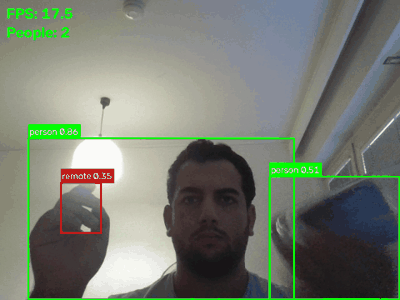

# spotter

Real-time person and object detection from a webcam feed using YOLO and OpenCV.
People get a green box, all other objects get a red one, each labeled with the
class name and confidence. FPS and the number of people are shown in the top-left corner.



## How it works

1. OpenCV reads frames from the webcam in a loop.
2. Each frame goes through the YOLO11 nano model (Ultralytics), which returns
   bounding boxes, class names and confidence scores.
3. OpenCV draws the boxes and labels, plus FPS and a people count, and shows the frame.

## Requirements

- Python 3.9+
- A webcam

## Install

```bash
git clone <your-repo-url>
cd spotter
python -m venv venv
```

Activate the virtual environment:

```bash
# Windows (PowerShell)
.\venv\Scripts\Activate.ps1

# macOS / Linux
source venv/bin/activate
```

Install the dependencies:

```bash
pip install ultralytics opencv-python
```

## Run

```bash
python spotter.py
```

The first run downloads the model weights (`yolo11n.pt`, about 5 MB).
Press **q** in the video window to quit.
